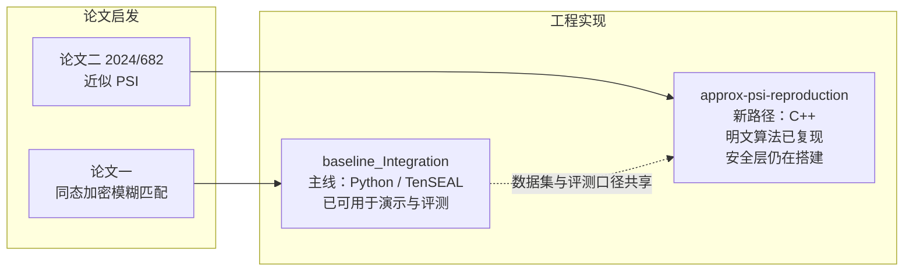

# SCUT Fuzzy Matching

> 隐私保护模糊姓名匹配研究项目：让两个互不信任的参与方，在不泄露各自数据的前提下，判断这个姓名是否在目标数据库里。

项目依托两篇论文的启发，沿两条技术路径推进：

| 路径 | 论文启发 | 核心思路 | 代码位置 | 当前阶段 |
| :--- | :--- | :--- | :--- | :--- |
| **同态加密匹配** | [*Privacy-preserving Fuzzy Name Matching for Sharing Financial Intelligence*](arxiv.org/abs/2407.19979) | 姓名编码成签名向量，在同态加密的密文上完成匹配；用聚类把全库扫描剪枝为少量候选 | `baseline_Integration/` | 端到端可用，已具备多语言、多属性、批量加密能力 |
| **近似 PSI** | [*Approximate PSI with Near-Linear Communication*](https://eprint.iacr.org/2024/682) | 用近似私有集合求交做模糊匹配，通信量理论上接近线性 | `approx-psi-reproduction/` | 复现与可行性验证中 |



两条路径面向同一个业务问题，共享数据集与评测口径；技术栈彼此独立，便于公平对比。

## 目录导览

| 目录 | 内容 |
| :--- | :--- |
| `baseline_Integration/` | 主线实现：协议、多语言、多属性、批处理、演示与测试 |
| `approx-psi-reproduction/` | 新路径复现：近似 PSI 明文算法与安全子协议层 |
| `fused-secure-filter/` | C++ 融合安全过滤研究分支；后端构建说明与历史测量独立保留 |
| `experiments/single_attribute/` | 单姓名实验：融合 CKKS 快照、四种选簇/过滤变体、待核验 RLdata 资料 |
| `multi_attribute_comparison/` | 多属性对比的数据集、脚本、日志与报告，不与单姓名实验混算 |
| `docs/reviews/`、`deliveries/` | 交付审阅、来源指纹和目录迁移记录 |
| `specs/` | 需求规约（PRD、术语表、索引、验收证据） |
| `baseline/` | 早期分工阶段的模块原型与接口规范（历史留档） |

## 快速开始

```powershell
cd baseline_Integration
python -m venv .venv
.\.venv\Scripts\Activate.ps1
python -m pip install -r requirements.txt
python -m pytest tests -q          # 全量回归测试
python scripts/demo_sage_cross_script.py   # 多语言演示
python scripts/demo_multi_attribute_dataset.py --config config/examples/fused_multilingual_multi_attribute.json # 多语言+多属性融合
```

各路径的详细说明见对应目录下的 README。

## 文档

- 需求规约（PRD）：`specs/matching/matching_fuzzy_match.req.md`
- 全局术语表：`specs/GLOSSARY_GLOBAL.md`
- 设计文档与阶段报告：`baseline_Integration/docs/`
- 单姓名实验入口：[`experiments/single_attribute/README.md`](experiments/single_attribute/README.md)
- 本次整理记录：[`docs/integration/delivery_2026-10-25.md`](docs/integration/delivery_2026-10-25.md)

`baseline_Integration/` 是主线，实验快照不能整目录覆盖它。原始 ZIP 留在被忽略的
`deliveries/local/`，Git 只保存去重后的源码、补丁、必要结果和来源清单；新交付放入 `代办/`。
