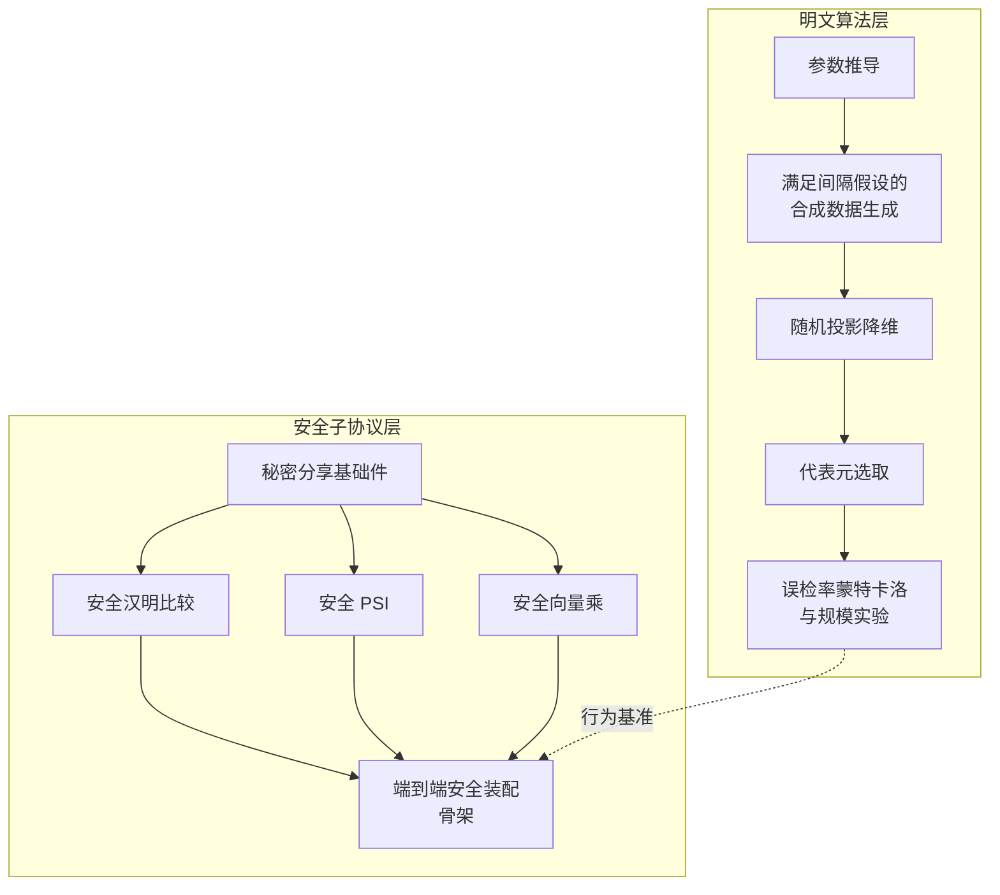

# 新路径：近似 PSI 复现与可行性验证

> 论文启发：[*Approximate PSI with Near-Linear Communication*](https://eprint.iacr.org/2024/682)（Chongchitmate, Lu, Ostrovsky, ePrint 2024/682）
> 这是本仓库的探索路径，目标是验证该方案能否作为主线方案的替代或补充。

## 论文的方法

主线方案在同态加密的密文上做模糊匹配，开销主要来自密文运算。这篇论文换了一个角度：把"近似匹配"直接做成**近似私有集合求交**——两个集合中"足够接近"的元素即视为交集成员。它在汉明距离上把通信量做到了接近线性，并通过低失真嵌入把编辑距离、欧氏距离、角距离（进而余弦相似度）都归约到同一框架。

如果这条路走通，模糊姓名匹配有希望摆脱同态加密的重计算开销，获得数量级更优的通信与运行时成本。

## 我们的设计



- **明文算法层**：完整复现论文 Algorithm 1 的骨架——参数推导、合成数据、随机投影、代表元选取，并跑通误检率与规模实验。这层用于回答"这个算法在我们要解决的问题上行为对不对"。
- **安全子协议层**：搭建论文要求的各个安全子协议（秘密分享、安全汉明距离、安全 PSI、安全向量乘），当前接口与回退仿真已就位，真实密码学后端尚未接入。

## 当前阶段

**只搭建了方法的骨架与可行性验证实验设计，尚不构成论文的完整密码学复现。**

具体地说：

- 安全汉明比较与向量乘在没有真实后端时会在本地重构数值，仅用于验证模块接线
- 安全 PSI 目前使用明文等价回退
- 端到端安全装配只完成了骨架，未走完完整的候选验证与输出路径

## 构建与运行

```bash
cmake -S . -B build
cmake --build build -j
ctest --test-dir build --output-on-failure
```

明文实验：

```bash
./build/approx_psi_plain --n 16 --ell 128 --d 4 --t 4 --lambda 10 --matches 4 --trials 500 --seed 42
bash experiments/run_fnr_sweep.sh        # 误检率扫描
bash experiments/run_table3_params.sh    # 论文 Table 3 参数
```

安全层测试（当前走回退路径）：`./build/test_secret_share`、`./build/test_ss_hamming`、`./build/test_ss_vmult`、`./build/test_ss_psi`、`./build/test_secure_approxpsi`。

构建产物（`build/` 等）已被 `.gitignore` 排除，请勿提交。

## 目录结构

```text
include/            明文算法头文件
include/secure/     安全子协议头文件
src/                明文实现
src/secure/         安全层实现与回退
secure_demo/        两方演示脚手架
experiments/        误检率与论文参数实验脚本
tests/              明文与安全层测试
```

## 下一步

1. 接入与论文兼容的 EMP-Toolkit 版本，替换安全汉明与向量乘的回退分支
2. 集成 volepsi/OPPRF 后端，替换安全 PSI 的明文回退
3. 补完端到端安全装配：PSI 产出的份额流入安全汉明验证与向量乘，只公开允许的输出
4. 实测通信量与安全运行时，复现论文 Figure 5 / Table 3
5. 与主线方案在统一数据集与评测口径下对比
