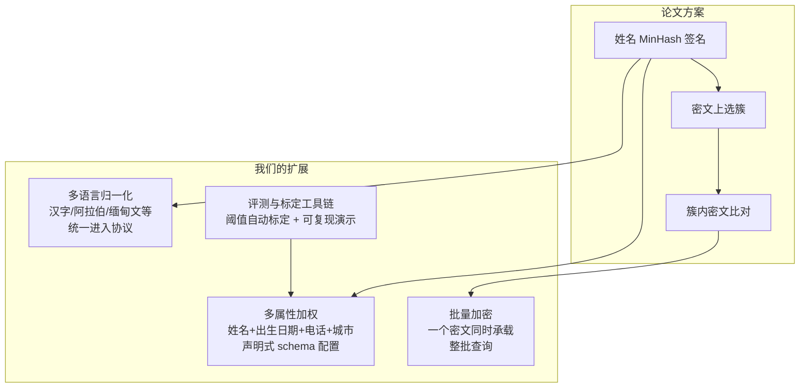
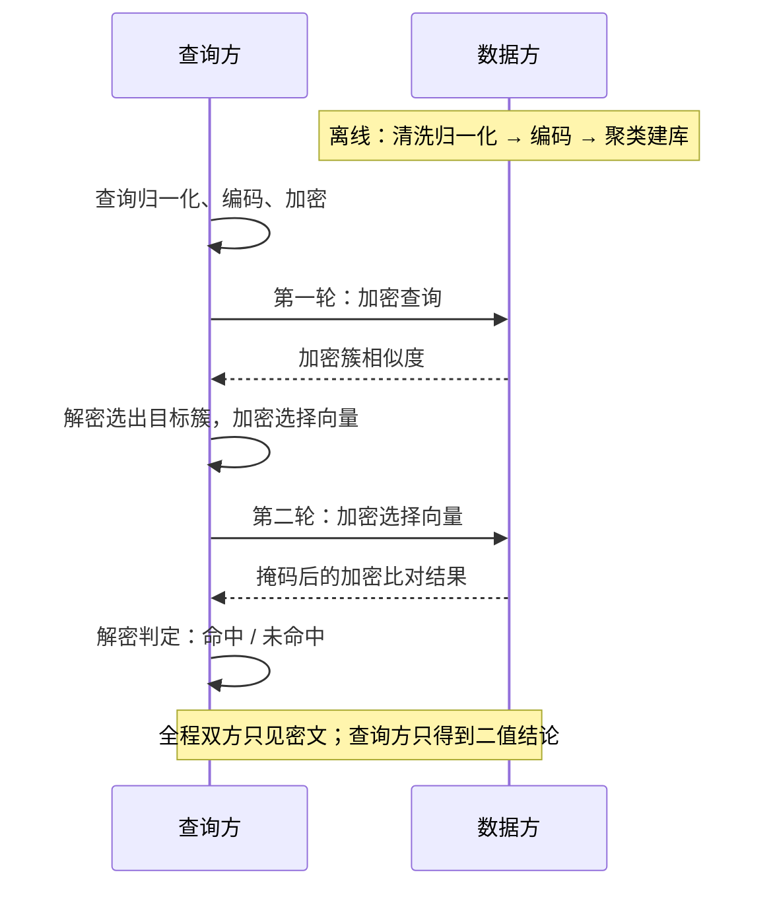

# 主线：基于同态加密的模糊姓名匹配

> 论文启发：*Privacy-preserving Fuzzy Name Matching for Sharing Financial Intelligence*
> 作为checkpoint1的研究主题，已实现高效的端到端可用的两方隐私保护匹配协议。

## 解决什么问题

反洗钱、金融情报共享等场景中，两个机构想核对"同一个人是否同时出现在双方名单里"，但谁都不愿交出明文名单。难点在于姓名很少完全一致：拼写错误、缩写、文字系统不同，比如汉字到拉丁的转写等场景，都会让精确匹配失效，所以需要的是**模糊匹配**，而且要在**密文上**完成。

## 论文方法

论文的核心思路是：把姓名编码成数值签名向量，双方交换密文，在密文上计算相似度。为了不做全库扫描，数据方离线时对库做聚类，查询方先在密文上选出最可能的簇，再只对簇内候选做精细比对——搜索空间从全库缩小到一个簇。

## 对于论文复现的设计

**论文给的是单语言、单属性、逐条查询的方案。我们围绕真实场景，面对国际化金融企业的真实业务需求，做了四个方向的扩展：**



- **多语言**（`data_pipeline/`）：不同文字系统的姓名先归一化，再连同拉丁转写变体一起入库，查询用任何一种形式都能命中。例如拉丁转写 `LiaoXueGuang` 能命中原生汉字 `廖學廣`。
- **多属性**（`multi_attribute/`）：不止匹配姓名，还能把出生日期、电话、城市等属性按权重加权打分。属性类型、权重、阈值全部由一份 JSON schema 声明，阈值用带标注数据自动标定，不靠手调。
- **批量加密**（`ckks/tiling.py`）：把整批查询打包进同一个密文并行计算，通信量相比逐条处理降低两个数量级。
- **工具链**（`scripts/`、`evaluation/`）：数据准备、阈值标定、演示、评测全部脚本化，固定种子可复现。

## 协议流程



## 快速开始

```powershell
python -m venv .venv
.\.venv\Scripts\Activate.ps1
python -m pip install -r requirements.txt
python -m pytest tests -q
```

依赖使用正式包名 `scikit-learn`，不要安装旧的 `sklearn` 占位包。

demo演示入口：

```powershell
python scripts/demo_sage_cross_script.py        # 多语言跨文字匹配
python scripts/demo_multi_attribute_dataset.py --config config/examples/febrl_multi_attribute.json --limit 50   # 多属性匹配
python scripts/demo_multi_attribute_dataset.py --config config/examples/fused_multilingual_multi_attribute.json --limit 0   # 多语言+多属性融合（全部 50 条）
python scripts/demo_multi_attribute_dataset.py --config config/examples/fused_multilingual_demo10.json --limit 0   # 融合数据集演示子集（10 条查询约几十秒，适合现场演示）

# 本地 Web 可视化交互界面（集成多属性多语言 + 单属性双模式）：
python gui_server.py --port 5000
# 在浏览器打开 http://localhost:5000
```

`demo_multi_attribute_dataset.py` 不带 `--limit` 时默认只跑前 20 条查询（每条查询都是一次
完整的双轮 HE 运算，全量跑要耐心等）；`--limit 0` 表示跑全部查询。终端报告带 ANSI 颜色，
管道/重定向时自动降级为无色纯文本，也可以加 `--no-color` 强制关闭；逐查询表显示查询样本的
真实姓名（qxx 代号只用于内部关联与落盘产物）。

### 聚类策略对照（研究配置）

```powershell
# 随机投影复聚类：第一轮使用 128 维，第二轮仍是原 50 维余弦精判
python scripts/evaluate_ncvr_10k.py --batch-size 200 --k 50 --projection-dim 128 --projection-seed 42 --probes 1 --no-early-stop

# 零块跳过可与上述参数组合；只省略 B 侧全零明文块的无效乘加
python scripts/evaluate_ncvr_10k.py --batch-size 200 --k 50 --projection-dim 128 --skip-zero-blocks --no-early-stop

# 基线 / 投影 / 增簇 / 双探针 / 零块组合的统一对照，结果写入 artifacts/evaluation/cluster_strategy_comparison/
python scripts/compare_ncvr_cluster_strategies.py --repeats 3 --warmup 1

# 已有七组各三次原始结果时，仅重建汇总（核对配置/manifest，不重复跑 HE）
python scripts/compare_ncvr_cluster_strategies.py --reuse-raw --repeats 3 --warmup 1
```

随机投影矩阵只由公开种子决定，不学习 B 方数据；投影后重新聚类，不用低维点积近似旧质心分数。`--probes` 为每个查询展开独立的 query×probe 计算，任一簇独立越过原阈值才算命中，不把跨簇相似度相加。`--skip-zero-blocks` 只依据 B 自己的零填充块跳过运算，不依赖查询内容，也不改变通信结果。默认不启用投影、零块跳过且 `probes=1`，原链路行为不变；是否升级默认配置以真实 HE 对照结果为准。

2026-10-21 七组真实 CKKS 对照已完成（各三次，200 查询、30 个正查询单字符扰动、关闭 early-stop）：原 k50＋零块跳过与基线逐查询结果一致，在线中位数为 48.28s 对 95.72s，通信均约 132.28 MiB。两批计时分开执行且补充组波动较大，此处仅报告观察结果，不承诺固定加速比。RP128/k50 的测试召回从 .78 降至 .76；RP128/k100 为 .80，但耗时 168.03s，双探针 341.60s 且没有额外测试半集增益。全部配置继续保持可选，详见 `docs/project_status_report.md` 最新章节及上述目录中的 JSON/CSV。

零块跳过的调度可能反映 B 的填充结构；当前实现没有形式化的时间侧信道隐藏保证。汇总的 `reference_positive_recall` 是查询级全库阈值阳性召回，不是特定 reference 记录的候选召回。

## 数据

| 数据集 | 位置 | 用途 |
| :--- | :--- | :--- |
| NCVR 10K | `data/ncvr_10k/` | 英文姓名真实子集，主评测基准 |
| SAGE | `data/sage/` | 12 万行、23 国多语言姓名库，含跨文字验证查询 |
| FEBRL | `dataset/febrl/`| 六属性记录链接公开基准 |
| fused_multilingual | `data/fused_multilingual/` | 自建库 多语言姓名+合成属性的小数据集 |

## 目录结构

```text
baseline_Integration/
├── ckks/                  # CKKS 上下文、密钥与二维批处理布局
├── clustering/            # K-Means 聚类
├── config/                # 全局参数与 job 配置示例
├── data_pipeline/         # 数据适配、多语言归一化、评测扰动
├── data/                  # 入库的小型数据集
├── dataset/               # 本地大数据集
├── docs/                  # 设计文档与阶段报告
├── evaluation/            # 指标、通信量、报告
├── minhash/               # MinHash 编码
├── multi_attribute/       # 多属性 schema、编码、协议、标定
├── party_a/               # 查询方：准备、选簇、判定
├── party_b/               # 数据方：建库、密文比对
├── preprocessing/         # 姓名清洗
├── protocol/              # 协议编排
├── scripts/               # 演示、评测、标定、数据生成脚本
├── tests/                 # 回归测试
└── gui_server.py          # demo 级本地可视化
```

## 当前阶段与验证状态

协议端到端可用，回归测试通过。关键验收结果见需求文档： `../specs/matching/matching_fuzzy_match.req.md` ，实测日志： `../specs/matching/evidence/`。

历史性能数据的口径说明：2026-07 的一组数字与后续 30% 扰动评测的运行条件不同，**不能互相比较得出加速结论**；

## 下一步

- 密文计算核下沉到 C++ 层，进一步压缩在线耗时
- 更强的模糊查询集：缩写、姓名顺序变化、昵称
- 与 `../approx-psi-reproduction/` 路径在统一数据集与评测口径下做对比
