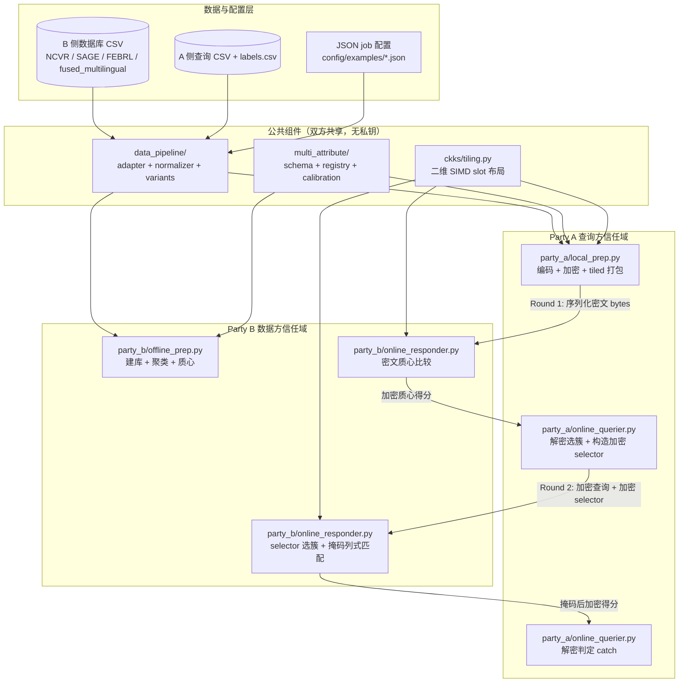
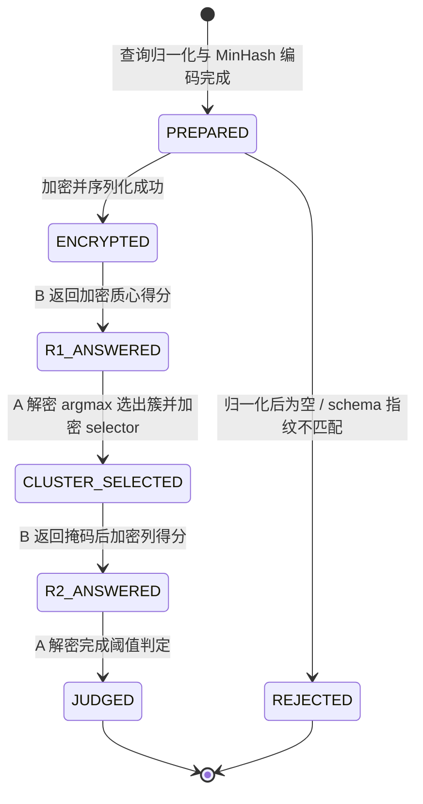
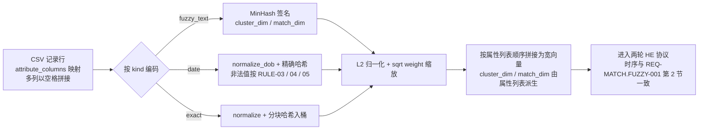
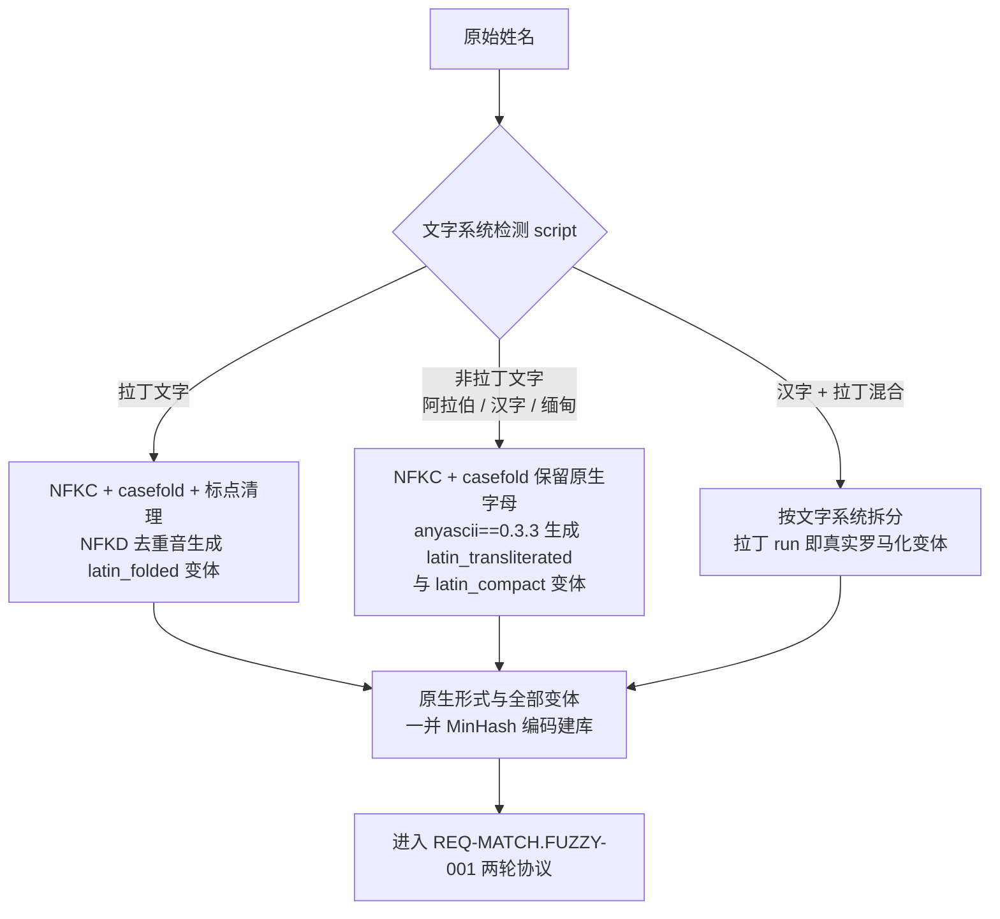

# 隐私保护模糊姓名匹配系统需求规约 (PRD)

> **文档类型**：业务需求规约（PRD 级契约，`*.req.md`）
> **遵循规范**：requirement_standard v1.1.0（统一企业级规约标准模板，按需裁剪）
> **版本**：v1.1.0
> **编写日期**：2026-10-14
> **业务域**：MATCH（隐私保护模糊匹配域）
> **特性**：MATCH.FUZZY（模糊姓名匹配特性）
> **全局索引**：`specs/REQUIREMENT_INDEX.json`
> **全局术语表**：`specs/GLOSSARY_GLOBAL.md`（所有术语唯一定义于此，本文档仅引用）
> **需求负责人**：业务负责人 待确认；技术负责人 待确认（当前维护方为 SCUT 模糊匹配项目组，见待确认清单 P-01）

---

## 一、项目背景与目标

### 1.1 背景

本项目复现并优化论文 *Privacy-preserving Fuzzy Name Matching for Sharing Financial
Intelligence* 的基线方案。场景为两个互不信任的参与方之间的隐私保护姓名匹配：

- **Party A（查询方）**：持有待查询姓名集合，希望知道每条查询是否出现在 Party B
  的数据库中，但不向 B 泄露明文查询。
- **Party B（数据方）**：持有姓名数据库，愿意提供匹配服务，但不向 A 泄露任何
  库内记录。

协议技术栈：**MinHash 局部敏感哈希签名 + 余弦/球面 K-Means 聚类剪枝 + CKKS
同态加密（TenSEAL 实现）+ 随机正掩码阈值判定**。A 发出的请求与 B 返回的响应
均为密文，任何一方的明文数据不离开本地。

工程实现位于 `baseline_Integration/`；`approx-psi-reproduction/` 为独立的近似
PSI 复现子项目，当前版本不展开规约，作为研究演进方向见 1.5 节与待确认清单
P-06。

### 1.2 目标

| 阶段 | 目标 | 衡量口径 |
| :--- | :--- | :--- |
| Stage 1 基线复刻 | MinHash + CKKS FHE + K-Means 完整端到端协议可用 | 精度约 100%；召回率不低于 96%（基线目标）；通信量相比无聚类线性搜索降低 30 至 300 倍 |
| Stage 2 优化改进 | 编码、聚类、阈值、批处理、通信压缩、混合协议六个方向的实测改进 | 所有改进声明必须有实测数据支撑，禁止无测量断言 |

### 1.3 系统性质声明（范围边界）

本系统是**研究型离线流水线（research pipeline）**，而非在线服务。以下章节按
规范显式声明为不适用，不强行填充：

| 模板要素 | 声明 | 理由 |
| :--- | :--- | :--- |
| HTTP API / 路由锚点 | 不适用 (N/A) | 系统无对外 HTTP 接口；交互锚点为 CLI 脚本与 Python 函数入口 |
| 用户登录 / RBAC 权限矩阵 | 不适用 (N/A) | 无用户体系；两方角色（Party A / Party B）为协议角色而非账号 |
| 数据库 CRUD / 数据迁移 | 不适用 (N/A) | 输入为 CSV 文件，输出为 artifacts JSON/CSV，无在线数据库 |
| 多租户与特性开关灰度 | 不适用 (N/A) | 单机研究代码，无租户概念 |
| Webhook / 异步回调 | 不适用 (N/A) | 无第三方回调链路 |
| 生产部署 SLO | 不适用 (N/A) | 研究阶段不定义生产 SLO，仅提供本机参考值（见第六节） |
| 端侧 GUI 交互规约 | 不适用 (N/A) | `baseline_Integration/gui_server.py` 为 demo 级本地可视化工具，不属正式交付范围 |

### 1.4 系统上下文与架构边界图



> 信任边界铁律：跨越 PartyA 与 PartyB 两个 subgraph 的所有箭头，承载物必须是
> 序列化密文 bytes；生产路径强制 `serialize()` 边界，B 侧仅持有公钥 context
> （无私钥，含 relinearization key）。

### 1.5 复杂场景拓展说明（对照规范第九节）

本项目的演进路径与 requirement_standard 第九节扩展规约的映射如下，各方向的
正式需求落点均已纳入本文档：

| 演进方向 | 对应规范拓展 | 本文档落点 | 仓内依据 |
| :--- | :--- | :--- | :--- |
| 单语言单属性 -> 多语言跨文字系统 | §9.6 全球化拓展 | REQ-MATCH.FUZZY-003（罗马化变体、`anyascii==0.3.3` 版本锁定） | `preprocessing/`、`data_pipeline/`、`config/examples/sage_pipeline.json` |
| 单属性 -> 多维度属性加权 | 需求增量演进（§9.7 类比） | REQ-MATCH.FUZZY-002 | V1->V2 演进留档于 `baseline_Integration/multi_attribute/MULTI_ATTRIBUTE_V1.md` / `MULTI_ATTRIBUTE_V2.md` |
| 单条查询加密 -> 批量 SIMD 打包加密 | §9.5 离线批处理 | REQ-MATCH.FUZZY-004 | 实测通信 133.3 MB vs 串行约 14.8 GB（2026-07-28 快照，`docs/project_status_report.md`） |
| 数据质量稽核（DQC） | §9.5 数据质量稽核要素 | 5.3 输出契约：数据管线的 `manifest.json`（行数 / 空值拒绝 / 去重 / 扰动计数）即本系统的 DQC 载体 | `data_pipeline/`、`scripts/prepare_dataset.py` |
| 第二篇论文方向：近似 PSI + 多次投影优化准确率 | 进行中的研究拓展 | 当前版本不展开规约；与主协议的集成方式未定，登记为待确认项 P-06 | `approx-psi-reproduction/`（注意：其 README 自述 secure 层仍为骨架与回退仿真，尚不能宣称端到端安全） |

---

## 二、用户故事

| 编号 | 角色 | 用户故事 | 关联需求 |
| :--- | :--- | :--- | :--- |
| US-01 | 数据方运营者（Party B） | 我希望把姓名库离线编码、聚类并建立索引，使后续在线查询无需重算建库，且我的明文记录永不离开本地 | REQ-MATCH.FUZZY-001 |
| US-02 | 查询方分析员（Party A） | 我希望用明文查询在本地加密后发起匹配，只获知"命中 / 未命中"的二值结论，且 B 无法得知我的查询内容与我选中的簇 | REQ-MATCH.FUZZY-001 |
| US-03 | 反洗钱调查员 | 当姓名拼写存在 typo、缩写或文字系统差异（如汉字与拉丁转写）时，仍应命中同一实体，以降低漏报 | REQ-MATCH.FUZZY-001 / 003 |
| US-04 | 数据科学家 | 我希望用姓名 + DOB + 电话 + 城市等多属性加权打分，并从带标注数据标定权重与阈值 tau，而不是手写魔法数字 | REQ-MATCH.FUZZY-002 |
| US-05 | 评测工程师 | 我希望批量查询在一次 CKKS 密文中并行完成，并能用固定种子复现评测结果、输出可审计的指标文件 | REQ-MATCH.FUZZY-004 |

---

## REQ-MATCH.FUZZY-001: 两方隐私保护模糊匹配核心协议

- **状态**: 明确
- **优先级**: P0
- **业务负责人**: 待确认
- **技术负责人**: 待确认
- **接口**: 不适用 (N/A)（无 HTTP 接口；锚点为 CLI `scripts/demo_ncvr_matches.py` /
  `scripts/evaluate_ncvr_10k.py` 与函数 `protocol.orchestrator.run_single_query_protocol`）
- **消息事件**: 不适用
- **幂等性机制**: 不适用（纯计算流水线，同一输入在固定 `random_state` /
  `HASH_SEED=42` 下确定性可复现）

### 1. 统一领域术语表 (Glossary)

本小节术语全部引用 `specs/GLOSSARY_GLOBAL.md`，不在此重复定义：`Party A`、
`Party B`、`MinHash`、`shingle`、`EL`、`CKKS`、`selector`、`tau (τ)`、
`mask`、`catch`、`centroid`、`cluster`。

### 2. 交互时序图 (Mermaid Sequence)

协议为固定的两轮结构（以 `scripts/demo_sage_cross_script.py` 的 6 阶段输出为
权威执行顺序参考）：

```mermaid
sequenceDiagram
    autonumber
    participant A as Party A (查询方)
    participant B as Party B (数据方)

    Note over B: 离线阶段: 清洗归一化 -> MinHash(EL=200/50) -> K-Means 聚类建库
    A->>A: 创建 CKKS 私钥 context，生成 relinearization key
    A->>B: 公开 context bytes（无私钥）
    A->>A: 查询归一化 + MinHash 编码 + 加密 + tiled 打包
    A->>B: Round 1 请求: 加密查询向量 (EL=200, 序列化 bytes)
    B->>B: 密文上计算 查询向量 x 各簇质心 点积
    B-->>A: Round 1 响应: 加密质心得分
    A->>A: 解密得分，argmax 选簇，构造 one-hot selector 并加密
    A->>B: Round 2 请求: 加密查询向量 (EL=50) + 加密 selector
    B->>B: selector 密文选取候选簇列; 列式密文点积; 减去 mask * tau
    B-->>A: Round 2 响应: 掩码后加密列得分
    A->>A: 解密并按 RULE-01/RULE-02/RULE-03 判定 catch
    Note over A,B: B 全程只见密文; A 只获得二值判定与本地 debug 信息
```

### 3. 领域状态迁移图 (Mermaid State Machine)

单条查询在协议中的生命周期：



> **[READ_FORMULA / 读表公式]**：查询状态机为线性单向往返流水线，不存在回退
> 边；任一阶段校验失败（空签名、NaN/Inf 得分、selector 非 one-hot）必须
> 立即终止并抛出异常，禁止带错继续。

### 4. 分支规则决策表 (DMN) - 阈值判定唯一权威源 (SSOT)

第二轮 A 侧解密后的逐列判定规则（实现锚点：
`party_a/online_querier.py::check_tiled_score_batch_debug`）。`s` 为某
(query, candidate) 对的解密掩码得分，`eps` 为数值灰区宽度
`BATCH_DECRYPT_EPS = 1e-4`（`config/params.py`）。

| 规则编号 | 解密得分 s (Input) | early_stop 且全部查询已命中 (Input) | 判定动作 (Output) | 状态流转 (Output) |
| :--- | :--- | :--- | :--- | :--- |
| `RULE-01` | `s > eps` | 任意 | 该列命中：记录首个命中列，该查询 `catch = true` | ALLOW -> `JUDGED`（可提前结束该查询判定） |
| `RULE-02` | `-eps <= s <= eps` | 任意 | 数值灰区，按未命中保守判负，继续检查后续列 | ALLOW -> 继续扫描 |
| `RULE-03` | `s < -eps` | 任意 | 未命中，继续检查后续列 | ALLOW -> 继续扫描 |
| `RULE-04` | 任意 | 是 | 停止消费剩余密文流（已得全部结论） | ALLOW -> `JUDGED` |
| `RULE-ELSE` | s 为 NaN / Inf | 任意 | 终止流程并抛出 `ValueError` | DENY: `ERR_NON_FINITE_SCORE` |

> **[READ_FORMULA / 读表公式]**：对每个 (query, candidate) 槽位，当解密得分
> 满足【得分区间条件】时，系统必须执行【判定动作】。若得分非有限值，强制
> 命中保底分支 `RULE-ELSE` 并终止。单查询结论 `catch = true` 当且仅当存在
> 至少一列命中 `RULE-01`。
>
> **[ROW_WALKTHROUGH / 逐行解析]**：
> - 代入用例 1：某列解密得分 `s = 0.42`（大于 `eps = 1e-4`）→ 命中
>   `RULE-01`，该查询判为 `catch = true`。
> - 代入用例 2：`s = 3e-5` 落在灰区内 → 命中 `RULE-02`，按未命中处理，
>   防止 CKKS 噪声翻转符号。
> - 代入用例 3：解密出现 NaN（context 被污染）→ 命中 `RULE-ELSE`，抛出
>   `ValueError`，禁止输出任何匹配结论。

### 5. 数据流字段规约表（协议线负载 Wire Payload）

| 字段名称 (Key) | 中文说明 | 数据类型 | 必填 | 约束与默认值 | 示例值 |
| :--- | :--- | :--- | :---: | :--- | :--- |
| `encrypted_query_200` | Round 1 加密查询（聚类签名） | bytes（CKKS 密文序列化） | 是 | 必须由 A 侧私钥 context 加密；序列化后传输 | 密文 bytes |
| `encrypted_query_50` | Round 2 加密查询（匹配签名） | bytes | 是 | 同上 | 密文 bytes |
| `encrypted_selectors` | 加密 one-hot selector | bytes | 是 | 明文形态必须为 one-hot（元素属于 {0,1} 且和为 1，加密前强制校验） | 密文 bytes |
| `public_context_bytes` | B 侧公开 CKKS context | bytes | 是 | 必须不含 secret key，含 relinearization key | context bytes |
| `tau` | 相似度阈值 | float | 是 | 取值见 5.4 阈值表（SSOT）；姓名单属性默认 `SIMILARITY_THRESHOLD = 0.9` | 0.9 |

### 6. 长事务执行与逆向补偿流水线

协议为无外部副作用的纯计算流水线，无跨系统资金/库存语义，逆向补偿统一为：
**无需补偿（任一步失败即抛异常终止，无中间状态需要回滚）**。

- **[STEP-01 B 侧离线建库]** 正向动作：清洗归一化、MinHash 双签名编码
  （EL=200 聚类 / EL=50 匹配）、K-Means 聚类（k 由 `choose_k` 决定，默认
  `sqrt`）。逆向补偿：不适用（只读）。
- **[STEP-02 A 侧查询准备与加密]** 正向动作：查询归一化、编码、加密、
  tiled 打包并序列化。逆向补偿：不适用。
- **[STEP-03 B 侧密文质心比较]** 正向动作：密文点积产生加密质心得分。
  逆向补偿：不适用。
- **[STEP-04 A 侧选簇]** 正向动作：解密质心得分，argmax 选簇，加密
  one-hot selector。逆向补偿：不适用。
- **[STEP-05 B 侧掩码列式匹配]** 正向动作：selector 密文选取候选簇，
  逐列密文点积并减去 `mask * tau`。逆向补偿：不适用。
- **[STEP-06 A 侧解密判定]** 正向动作：按第 4 节 DMN `RULE-01` ~
  `RULE-ELSE` 判定每条查询的 `catch`。逆向补偿：不适用。

### 7. 验收准则与安全红线 (EARS Prose & 结构化四元组 NC)

- **[AC-MATCH.FUZZY-001.01] 正样本命中**
  - **[PRE / 前置]**：B 侧库已按 STEP-01 建好，tau 按 5.4 阈值表配置，
  - **[WHEN / 触发]**：A 提交一条明文真匹配得分大于 tau 的查询（即
    should_catch 为真，定义见 5.4 指标表），
  - **[GUARD / 门控]**：协议各步无校验失败，
  - **[THEN / 行为]**：系统必须按 `RULE-01` 判定该查询 `catch = true`，
  - **[ELSE / 异常]**：若出现非有限解密得分，必须命中 `RULE-ELSE` 抛出
    异常而非静默判负。
- **[AC-MATCH.FUZZY-001.02] 负样本与灰区保守判负**
  - **[WHEN / 触发]**：A 提交一条库中不存在对应记录的查询，且所有列
    解密得分均不高于 `eps`，
  - **[THEN / 行为]**：系统必须判定 `catch = false`，且不得向 A 返回任何
    命中列的明文相似度数值。
- **[AC-MATCH.FUZZY-001.03] SAGE 跨文字验收**
  - **[WHEN / 触发]**：运行 `scripts/demo_sage_cross_script.py` 默认 9 条
    验证查询（5 正 4 负），
  - **[THEN / 行为]**：系统必须达到 9/9 = 100% 逐条判定正确（实测证据见
    第七节验收汇总，tau 取 5.4 阈值表 T-01）。
- **[NC-MATCH.FUZZY-001.01] B 侧私钥隔离红线**
  - 主体：Party B 全部在线/离线模块（`party_b/`）
  - 门控前提：加载或使用 CKKS context 时
  - 绝对禁止行为：严禁接收、反序列化或持有任何包含 secret key 的 context；
    B 侧只能使用公钥 context bytes
  - 范围与授权依据：适用于生产协议路径全生命周期；测试桩
    （`tests/test_security_boundary.py`）必须断言 B 侧 context 无私钥
- **[NC-MATCH.FUZZY-001.02] 选簇结果保密红线**
  - 主体：Party A 请求构造代码与传输层
  - 门控前提：向 B 发送 Round 2 请求时
  - 绝对禁止行为：严禁以明文形式向 B 传输 selected cluster id 或未加密的
    selector；本地 demo 输出中的 cluster/variant 信息仅限 debug 用途
  - 范围与授权依据：适用于所有协议调用路径，无例外
- **[NC-MATCH.FUZZY-001.03] 掩码独立性红线**
  - 主体：Party B Round 2 匹配核（`party_b/online_responder.py`）
  - 门控前提：生成 `mask * tau` 减项时
  - 绝对禁止行为：严禁对任意两个 (query, candidate) 对复用同一掩码值，
    严禁使用非正掩码；掩码必须逐对独立采样自
    `[RANDOM_MASK_MIN, RANDOM_MASK_MAX] = [1.0, 10.0]`
  - 范围与授权依据：适用于串行与二维 tiled 批处理全部路径

### 8. 待确认事项清单

不适用 (N/A)（本节无未决项；全局待确认见第八节）。

---

## REQ-MATCH.FUZZY-002: 多属性加权匹配（声明式 Attribute Schema）

- **状态**: 明确
- **优先级**: P0
- **业务负责人**: 待确认
- **技术负责人**: 待确认
- **接口**: 不适用 (N/A)（锚点为 CLI `scripts/demo_multi_attribute_dataset.py` /
  `scripts/calibrate_multi_attribute.py` 与函数
  `multi_attribute.protocol.run_multi_attribute_protocol`）
- **消息事件**: 不适用
- **幂等性机制**: 不适用（固定 seed 下确定性可复现）

### 1. 统一领域术语表 (Glossary)

引用全局术语表：`AttributeSchema`、`kind`、`weight`、`fingerprint`、
`impostor`、`should_catch`、`probes`、`calibration window`。

### 2. 交互时序图 (Mermaid Sequence)

不适用 (N/A)。两轮协议结构与 REQ-MATCH.FUZZY-001 完全一致（唯一差异是向量
宽度由属性列表派生），时序以 REQ-MATCH.FUZZY-001 第 2 节为唯一权威源。

补充下图：多属性装配数据流（为 REQ-MATCH.FUZZY-001 协议的输入准备阶段，
不改变协议时序）：



> 装配完成后协议时序与 REQ-MATCH.FUZZY-001 第 2 节一致；任一属性编码失败
> （含 schema 指纹不匹配）在加密前 fail-closed 终止。

### 3. 领域状态迁移图 (Mermaid State Machine)

不适用 (N/A)（查询生命周期与 REQ-MATCH.FUZZY-001 第 3 节一致）。

### 4. 分支规则决策表 (DMN) - 属性编码与缺失/非法值策略唯一权威源 (SSOT)

| 规则编号 | 属性 kind (Input) | 取值状态 (Input) | 策略参数 (Input) | 编码动作 (Output) | 处理结果 (Output) |
| :--- | :--- | :--- | :--- | :--- | :--- |
| `RULE-01` | `fuzzy_text` | 空值 / 空白 | 任意 | 编码为全零块（零贡献） | ALLOW -> 零块参与加权 |
| `RULE-02` | `date` | 可解析合法日期 | `day_first` 与格式匹配 | `normalize_dob` 后精确哈希编码 | ALLOW -> 正常编码 |
| `RULE-03` | `date` | `DD/MM/YYYY` 等有歧义格式 | `day_first=false`（默认） | 拒绝猜测性解析 | DENY: `ERR_AMBIGUOUS_DATE` |
| `RULE-04` | `date` | 不可解析 | `on_invalid="raise"`（默认） | fail-closed 抛错 | DENY: `ERR_INVALID_DATE` |
| `RULE-05` | `date` | 不可解析 | `on_invalid="missing"` | 视为缺失，编码全零块并计数审计 | ALLOW -> 零块（计数必须可见） |
| `RULE-06` | `exact` | 任意 | `normalize="digits"` | 剥离全部非数字字符后哈希入桶 | ALLOW -> 正常编码 |
| `RULE-07` | `exact` / `date` | 任意 | `tolerate` 已声明 | 逐位对齐编码（默认关闭，实测净负收益，开启前必须实测 median impostor） | ALLOW -> 对齐编码 |
| `RULE-08` | 任意 | 属性全列缺失 | 任意 | 该属性整块缺省（不写入 values），按零块处理 | ALLOW -> 零块参与加权 |
| `RULE-ELSE` | 未注册 kind | 任意 | 任意 | schema 校验期拒绝 | DENY: `ERR_UNREGISTERED_KIND` |

> **[READ_FORMULA / 读表公式]**：当属性满足【kind】且取值满足【取值状态】且
> 声明了【策略参数】时，系统必须执行【编码动作】。组合得分恒为
> `S = Σ wᵢ · simᵢ(attributeᵢ)`（各属性块 L2 归一化后按 `sqrt(wᵢ)` 缩放再
> 拼接，CKKS 点积天然展开为加权和）；权重与 tau 不在本表硬编码，取自标定
> 产物（见第 5.4 节阈值表 SSOT）。
>
> **[ROW_WALKTHROUGH / 逐行解析]**：
> - 代入用例 1：FEBRL dob = `19450493`（非法），`on_invalid="missing"`
>   → 命中 `RULE-05`，编码零块；demo 必须打印被零化的非法日期计数
>   （FEBRL 4b 实测 64/5000 = 1.3%）。
> - 代入用例 2：`05/03/2001` 且未声明 `day_first` → 命中 `RULE-03`，
>   阻断而非猜测。
> - 代入用例 3：schema 中出现 `kind="phonetic"`（未注册）→ 命中
>   `RULE-ELSE`，构造期抛错。

### 5. 数据流字段规约表（Attribute Schema JSON）

| 字段名称 (Key) | 中文说明 | 数据类型 | 必填 | 校验规则与边界约束 | 默认值 | 示例值 |
| :--- | :--- | :--- | :---: | :--- | :--- | :--- |
| `similarity_threshold` | 加权得分阈值 tau | float | 是 | 取值在 `[0, 1]`；必须由带标注数据标定，禁止手抄他数据集数值 | 无 | 0.485 |
| `attributes[].name` | 属性名 | String | 是 | 唯一且为合法标识符 | 无 | `"dob"` |
| `attributes[].kind` | 属性类型 | String | 是 | 枚举：`fuzzy_text` / `exact` / `date`（别名 `text`/`name`/`categorical`/`dob` 归一化） | 无 | `"date"` |
| `attributes[].weight` | 属性权重 | float | 是 | 非负有限；全部权重之和必须为 1.0（容差 `1e-9`） | 无 | 0.25 |
| `attributes[].params` | kind 专属参数 | Object | 是 | 仅允许该 kind 已注册的键（防拼写错误） | 无 | `{"blocks":2,"buckets_per_block":512}` |
| `name_attribute` | 姓名属性指针 | String | 是 | 必须指向已声明的 `fuzzy_text` 属性 | `"name"` | `"name"` |
| `cluster_dim` / `match_dim` | 派生向量宽度 | int | 派生 | 由属性列表求和派生，均不得超过 `CKKS_SLOT_LIMIT = 4096` | 派生 | 3272 / 3122 |

### 6. 长事务执行与逆向补偿流水线

不适用 (N/A)（同 REQ-MATCH.FUZZY-001，纯计算无外部副作用）。

### 7. 验收准则与安全红线 (EARS Prose & 结构化四元组 NC)

- **[AC-MATCH.FUZZY-002.01] schema 校验 fail-closed**
  - **[WHEN / 触发]**：构造或加载 `AttributeSchema` 时权重之和偏离 1.0
    超过 `1e-9`，或任一维度超过 4096，或存在未注册 kind，
  - **[THEN / 行为]**：系统必须在构造期抛出校验异常，禁止产出可用 schema。
- **[AC-MATCH.FUZZY-002.02] schema 指纹防错位**
  - **[PRE / 前置]**：A 侧查询与 B 侧建库分别基于两份 schema 编码，
  - **[WHEN / 触发]**：两侧 schema 指纹（fingerprint）不一致，
  - **[THEN / 行为]**：`prepare_party_a_multi_query` 与
    `run_multi_attribute_protocol` 必须抛出异常并打印两侧指纹，严禁
    在布局错位下产出貌似合理的错误得分。
- **[AC-MATCH.FUZZY-002.03] FEBRL 多属性验收**
  - **[WHEN / 触发]**：按 `config/examples/febrl_multi_attribute.json`
    运行加密 demo，
  - **[THEN / 行为]**：加密召回（should_catch 口径）必须达到 48/48 = 100%，
    第二轮扫描成本均值约 15.2 列（约为全量扫描的 3%）。实测证据见第七节
    验收汇总。
- **[AC-MATCH.FUZZY-002.04] 融合多语言多属性验收**
  - **[WHEN / 触发]**：按 `config/examples/fused_multilingual_multi_attribute.json`
    运行加密 demo，
  - **[THEN / 行为]**：should_catch 口径召回必须为 36/36 = 100%，
    10 条负例误报必须为 0，tau 取 5.4 阈值表 T-03。
- **[NC-MATCH.FUZZY-002.01] 阈值跨数据集移植红线**
  - 主体：评测工程师与配置编写者
  - 门控前提：更换数据集或属性集合后
  - 绝对禁止行为：严禁直接复用其他数据集的 tau 与权重而不重新运行
    `scripts/calibrate_multi_attribute.py` 标定
  - 范围与授权依据：适用于全部多属性 job 配置；`config/examples/` 中的
    数值仅为对应数据集的标定结果，不是通用默认值
- **[NC-MATCH.FUZZY-002.02] 召回口径防漂红线**
  - 主体：评估与报告代码（demo 汇总层）
  - 门控前提：计算与展示召回率时
  - 绝对禁止行为：严禁以"标签为正"为分母宣称召回率而不同时给出
    should_catch 口径的原始 `n/d`；严禁在不声明 tau 的情况下报告召回率
    （tau 上移会缩小分母虚增比率）
  - 范围与授权依据：适用于所有 demo / evaluation 报告输出

### 8. 待确认事项清单

不适用 (N/A)。

---

## REQ-MATCH.FUZZY-003: 多语言与跨文字系统归一化

- **状态**: 明确
- **优先级**: P1
- **业务负责人**: 待确认
- **技术负责人**: 待确认
- **接口**: 不适用 (N/A)（锚点为 CLI `scripts/demo_sage_cross_script.py` /
  `scripts/validate_sage_multilingual.py`，normalizer `unicode_v1`）
- **消息事件**: 不适用
- **幂等性机制**: 不适用（归一化为确定性纯函数；转写库版本锁定
  `anyascii==0.3.3`）

### 1. 统一领域术语表 (Glossary)

引用全局术语表：`unicode_v1`、`variant`、`latin_transliterated`、
`latin_compact`、`NFKC`、`casefold`、`anyascii`、`script`。

### 2. 交互时序图 (Mermaid Sequence)

不适用 (N/A)（归一化为离线预处理，无跨方交互；变体随建库一同进入
REQ-MATCH.FUZZY-001 的协议）。

补充下图：归一化流水线（数据流图，非跨方时序）：



> 各分支动作与本节第 4 小节 DMN `RULE-01` ~ `RULE-04` 一一对应（SSOT）；
> 清洗后为空签名的记录按 `RULE-ELSE` 拒绝入库并计入 manifest。

### 3. 领域状态迁移图 (Mermaid State Machine)

不适用 (N/A)。

### 4. 分支规则决策表 (DMN) - 归一化与变体生成唯一权威源 (SSOT)

| 规则编号 | 输入文字形态 (Input) | 归一化动作 (Output) | 变体生成 (Output) | 处理结果 (Output) |
| :--- | :--- | :--- | :--- | :--- |
| `RULE-01` | 拉丁文字（含重音，如匈牙利/意大利名） | NFKC + casefold + 标点清理 | `latin_folded`（NFKD 去重音） | ALLOW -> 双形式入库 |
| `RULE-02` | 非拉丁文字（阿拉伯文 / 汉字 / 缅甸文） | NFKC + casefold，保留原生 Unicode 字母 | `latin_transliterated` + `latin_compact`（anyascii 上下文无关转写） | ALLOW -> 原生 + 转写变体一并入库 |
| `RULE-03` | 汉字 + 拉丁混合行 | 按文字系统拆分 | 拉丁 run 即真实罗马化变体 | ALLOW -> 双形式入库 |
| `RULE-04` | 转写结果与本地形式仅差大小写 | 同 RULE-01/02 | 不生成重复变体（romanized 列留空） | ALLOW -> 单形式入库 |
| `RULE-ELSE` | 清洗后为空签名 | 拒绝该记录并计入 manifest 空值拒绝计数 | 无 | DENY: `ERR_EMPTY_SIGNATURE` |

> **[READ_FORMULA / 读表公式]**：当输入姓名满足【文字形态】时，系统必须执行
> 【归一化动作】并生成【变体生成】列所示变体；原生形式与全部变体共用同一套
> MinHash / 聚类 / HE 协议建库。清洗结果为空的记录强制命中 `RULE-ELSE`。
>
> **[ROW_WALKTHROUGH / 逐行解析]**：
> - 代入用例 1：`廖學廣`（纯汉字）→ 命中 `RULE-02`，原生形式与
>   `LiaoXueGuang` 转写变体同时入库，拉丁查询可跨文字命中。
> - 代入用例 2：`Árgyelán János`（拉丁重音）→ 命中 `RULE-01`，去重音
>   查询可命中。
> - 代入用例 3：输入仅含标点 → 清洗后为空，命中 `RULE-ELSE`，拒绝入库并
>   计入 manifest。

### 5. 数据流字段规约表

引用第五节 5.1 的 SAGE 与 fused_multilingual CSV schema（SSOT），此处不重复。

### 6. 长事务执行与逆向补偿流水线

不适用 (N/A)。

### 7. 验收准则与安全红线 (EARS Prose & 结构化四元组 NC)

- **[AC-MATCH.FUZZY-003.01] 跨文字命中**
  - **[WHEN / 触发]**：以拉丁转写形式（如 `LiaoXueGuang`）查询库中的
    原生文字姓名（如 `廖學廣`），
  - **[THEN / 行为]**：系统必须通过转写变体命中同一实体记录。
- **[AC-MATCH.FUZZY-003.02] SAGE 建库规模不变式**
  - **[WHEN / 触发]**：按 `config/examples/sage_pipeline.json` 执行
    SAGE 预处理，
  - **[THEN / 行为]**：123,479 行源数据必须清洗为 43,206 条标准记录，
    展开为 56,705 个去重搜索项；manifest 必须记录空值拒绝与去重计数。
- **[AC-MATCH.FUZZY-003.03] 多语言 demo 验收**
  - **[WHEN / 触发]**：运行 `scripts/demo_sage_cross_script.py`，
  - **[THEN / 行为]**：9 条验证查询（5 正 4 负，含 zh-romanized 与
    ar-romanized 跨文字用例）必须全部判定正确；单查询在线耗时参考值约
    788 ms（批内摊销，本机实测，非 SLO）。
- **[NC-MATCH.FUZZY-003.01] 转写确定性红线**
  - 主体：数据预处理管线（`data_pipeline/`、`preprocessing/`）
  - 门控前提：生成拉丁转写变体时
  - 绝对禁止行为：严禁使用未锁定版本的转写库或引入上下文相关、带随机性
    的转写逻辑；当前唯一允许的转写实现为固定版本 `anyascii==0.3.3`
  - 范围与授权依据：适用于全部建库与查询归一化路径；引入语言专用
    transliterator 必须走 variant 注册边界，不得改动 HE 协议
- **[NC-MATCH.FUZZY-003.02] 评测扰动隔离红线**
  - 主体：数据管线扰动模块（`data_pipeline/` perturbation）
  - 门控前提：执行可复现模糊化评测时
  - 绝对禁止行为：严禁将扰动写入 B 侧数据库或生产查询；扰动仅允许作用于
    评测查询副本，且必须使用固定种子（如 `fuzzy_ratio=0.3, seed=42`）
  - 范围与授权依据：适用于全部评测脚本

### 8. 待确认事项清单

不适用 (N/A)。

---

## REQ-MATCH.FUZZY-004: CKKS 二维 query x candidate SIMD 批处理

- **状态**: 明确
- **优先级**: P1
- **业务负责人**: 待确认
- **技术负责人**: 待确认
- **接口**: 不适用 (N/A)（锚点为 `scripts/benchmark_he_batching.py` 与
  `scripts/evaluate_ncvr_10k.py --batch-size`，实现 `ckks/tiling.py`）
- **消息事件**: 不适用
- **幂等性机制**: 不适用

### 1. 统一领域术语表 (Glossary)

引用全局术语表：`slot`、`tile`、`batch_size (m)`、`tile_width (T)`、
`active_slots`、`BATCH_DECRYPT_EPS`、`early stop`。

### 2. 交互时序图 (Mermaid Sequence)

不适用 (N/A)（批处理改变的是密文打包布局，不改变 REQ-MATCH.FUZZY-001 的
两轮时序）。

### 3. 领域状态迁移图 (Mermaid State Machine)

不适用 (N/A)。

### 4. 分支规则决策表 (DMN) - 批尺寸校验与 tile 布局唯一权威源 (SSOT)

CKKS 参数（`config/params.py`）：`POLY_MODULUS_DEGREE = 8192`，
`COEFF_MOD_BIT_SIZES = [60, 40, 40, 60]`，`SCALE = 2^40`，单密文可用
slot 数 `S = 4096`。

| 规则编号 | 批大小 m (Input) | 布局推导 (Output) | 处理结果 (Output) |
| :--- | :--- | :--- | :--- |
| `RULE-01` | `1 <= m <= 4096` | `T = floor(S / m)`；`active = m * T <= S`；槽位编址 `slot(q, t) = q * T + t`；Round 1 tile 数 `ceil(k / T)`，Round 2 tile 数 `ceil(L / T)`（L 为最大簇长） | ALLOW -> 按布局打包 |
| `RULE-02` | 任意合法 m | padding 槽必须置零且 mask 取 1，unpack 按 `valid_width` 丢弃尾部 | ALLOW -> 判定不受 padding 污染 |
| `RULE-ELSE` | `m <= 0` 或 `m > 4096` 或非整数 | 拒绝构造批请求 | DENY: `ERR_INVALID_BATCH_SIZE` |

> **[READ_FORMULA / 读表公式]**：当批大小满足【批大小 m】条件时，系统必须按
> 【布局推导】构造 slot 布局；非法批大小强制命中 `RULE-ELSE` 并抛出
> `ValueError`。每个 (query, candidate) 对仍采样独立正随机掩码，安全性与
> 串行路径逐位一致（引用 `NC-MATCH.FUZZY-001.03`）。
>
> **[ROW_WALKTHROUGH / 逐行解析]**：
> - 代入用例 1：`m = 200, k = 50, L = 483` → 命中 `RULE-01`，`T = 20`，
>   `active = 4000`（利用率约 97.7%），Round 1 产出 `ceil(50/20) = 3` 个
>   密文，Round 2 产出 `ceil(483/20) = 25` 个密文。
> - 代入用例 2：`m = 5000` → 命中 `RULE-ELSE`，抛出 `ValueError`。

### 5. 数据流字段规约表

不适用 (N/A)（复用 REQ-MATCH.FUZZY-001 第 5 节线负载，仅密文内部布局不同）。

### 6. 长事务执行与逆向补偿流水线

不适用 (N/A)。

### 7. 验收准则与安全红线 (EARS Prose & 结构化四元组 NC)

- **[AC-MATCH.FUZZY-004.01] 密文数量不变式**
  - **[WHEN / 触发]**：以 `m = 200` 批大小运行固定尺寸链路
    （`k = 50, L = 483`），
  - **[THEN / 行为]**：Round 1 响应必须严格为 3 个密文、Round 2 响应必须
    严格为 25 个密文，与 `RULE-01` 推导一致。
- **[AC-MATCH.FUZZY-004.02] 数值等价比率**
  - **[WHEN / 触发]**：同一批查询分别以串行路径与 tiled 批处理路径执行，
  - **[THEN / 行为]**：两条路径的正负号判定一致率必须为 100%，解密绝对
    误差必须落在 `BATCH_DECRYPT_EPS` 灰区管控范围内（实测最大绝对误差
    9.6e-5 以内，见第七节证据）。
- **[AC-MATCH.FUZZY-004.03] 回归测试门禁**
  - **[WHEN / 触发]**：提交协议、批处理或数据管线代码变更，
  - **[THEN / 行为]**：`python -m pytest tests -q` 必须全部通过（当前实测
    279 passed / 2 skipped / 252 s，2026-10-14 本机复跑，见第七节证据）。
- **[NC-MATCH.FUZZY-004.01] 生产序列化边界红线**
  - 主体：批处理生产路径（`party_a` / `party_b` / `protocol.transport`）
  - 门控前提：A 与 B 之间传递任何密文或 context 时
  - 绝对禁止行为：严禁绕过 `serialize()` 以内存对象直传方式调用 B 侧
    核函数；B 侧必须经 `ts.ckks_vector_from(public_context, ...)` 重建密文
  - 范围与授权依据：适用于生产路径；单元测试内的同进程直传仅为测试桩，
    不构成授权例外

### 8. 待确认事项清单

不适用 (N/A)。

---

## 五、数据契约（输入 / 配置 / 输出）

### 5.1 输入 CSV Schema（数据字典）

**NCVR 10K（`baseline_Integration/data/ncvr_10k/`）**

| 文件 | 字段 | 中文说明 | 类型 | 必填 | 约束 | 示例 |
| :--- | :--- | :--- | :--- | :---: | :--- | :--- |
| `ncvr_10k_database.csv` | `ncid` | B 侧记录 ID | String | 是 | 唯一 | `"n1"` |
| `ncvr_10k_database.csv` | `full_name` | B 侧姓名 | String | 是 | 经 `english_v1` 清洗 | `"john smith"` |
| `ncvr_10k_queries.csv` | `query_ncid` | 查询关联 ID | String | 是 | 正样本指向库内记录 | `"n1"` |
| `ncvr_10k_queries.csv` | `query_name` | 查询姓名 | String | 是 | 评测时可按 `fuzzy_ratio` 扰动 | `"johm smith"` |
| `ncvr_10k_queries.csv` | `label` | 真值标签 | bool | 是 | true=正样本 | `true` |

**fused_multilingual（`baseline_Integration/data/fused_multilingual/`）**

| 文件 | 字段 | 中文说明 | 类型 | 必填 | 约束 | 示例 |
| :--- | :--- | :--- | :--- | :---: | :--- | :--- |
| `database.csv` | `record_id` | 记录 ID | String | 是 | 形如 `fused-xxxxxxxx` | `"fused-00000001"` |
| `database.csv` | `name_local` | 本地文字姓名 | String | 否 | 与 `name_romanized` 至少其一非空 | （原生文字姓名） |
| `database.csv` | `name_romanized` | 罗马化姓名 | String | 否 | 仅差大小写时留空 | `"LiaoXueGuang"` |
| `database.csv` | `dob` / `city` / `phone` | 合成属性 | String | 否 | DOB 为 ISO 日期；电话 E.164 与本地格式混用 | `"1974-03-05"` |
| `database.csv` | `country` | 国家 | String | 是 | SAGE 源国家 | `"Taiwan"` |
| `queries.csv` | `query_id` + 同名字段 | 查询（只带一种姓名形式） | String | 是 | 正例至多 2 处扰动 | `"q01"` |
| `labels.csv` | `query_id` / `true_entity_id` / `label` | 真值 | String | 是 | 负例 `true_entity_id` 为空 | `"true"` |

**通用 csv_pair adapter**：数据库部分至少配置 `path`、`name_column`；查询部分
至少配置 `path`、`name_column`；可选 `id_column`、`label_column`、
`match_id_column`、`expected_ids_column`、`country_column`、`language_column`、
`metadata_columns`。SAGE 源表经 `sage_names` adapter 清洗（规模不变式见
`AC-MATCH.FUZZY-003.02`）。

### 5.2 配置契约（JSON job 文件）

多属性 job 文件字段以 REQ-MATCH.FUZZY-002 第 5 节为 SSOT；另有
`attribute_columns`（属性到 CSV 列的映射，多列以空格拼接）、`id_column`、
`database`、`queries`、`labels`、`link_mode`（如 `febrl`）。示例：
`config/examples/febrl_multi_attribute.json`、
`config/examples/fused_multilingual_multi_attribute.json`。

### 5.3 输出契约

| 输出物 | 路径模式 | 内容 |
| :--- | :--- | :--- |
| demo 报告 | `artifacts/demo/<name>/*.json` + `*.csv` | 每查询一行：判定、should_catch、期望分、冒充者分、逐属性得分、扫描列数、漏报归因 |
| 评测报告 | `artifacts/evaluation/<run>/*.json/csv/png` | precision / recall / f1 / accuracy、混淆矩阵、通信量 |
| 数据准备 | `artifacts/prepared/<name>/` | `database.csv`、`queries.csv`、`manifest.json`（行数、空值拒绝、去重、扰动计数） |

> 数据质量稽核（DQC）：`manifest.json` 即本系统的 DQC 载体（对应规范 §9.5 的
> 数据质量稽核要素），每次数据准备必须落盘行数、空值拒绝、去重与扰动计数，
> 供评审与复现核对。

### 5.4 阈值与验收指标定义（SSOT）

**阈值表（唯一定义处，其他章节一律引用 T-xx）**

| 编号 | 适用配置 | tau | 标定依据 |
| :--- | :--- | :---: | :--- |
| T-01 | 姓名单属性协议（NCVR / SAGE） | 0.9 | `config/params.py::SIMILARITY_THRESHOLD` |
| T-02 | FEBRL 六属性（手写基线配置） | 0.6 | 40 条查询实测冒充者最高 0.579，取略高于它；需正式标定后更新 |
| T-03 | fused_multilingual 四属性 | 0.485 | 50 条查询明文标定：负例冒充者最高 0.452、全局冒充者上限 0.481 |

**指标定义（唯一定义处）**

| 指标 | 定义 |
| :--- | :--- |
| `should_catch` | 真匹配的明文得分 > tau（严格大于，与第二轮同口径） |
| `recall (should_catch 口径)` | `#{catch 且 should_catch} / #{should_catch}`，分母不是"标签为正" |
| `cluster recall` | 真匹配所在簇被探测覆盖的正例比例；`top1-only` 变体仅计首轮 argmax 簇 |
| `impostor` | 某查询的非匹配库记录中的最高得分者 |
| `calibration window` | 区间 `[最低真匹配得分, 最高冒充者得分]`；两者交叠时无单一 tau 兼得满召回与零误报 |

---

## 六、非功能需求

### 6.1 性能

生产 SLO：不适用 (N/A)（研究阶段不定义生产 SLO，见 1.3 节）。以下为研究环境
本机实测参考值，不构成 SLO：

| 场景 | 实测值 | 证据 |
| :--- | :--- | :--- |
| SAGE 跨文字 demo（9 查询批） | 单查询摊销约 788 ms；HE 批总计 7.096 s | `artifacts/demo/sage_cross_script/` |
| NCVR 10K、200 查询、fuzzy_ratio=0.3、batch=200 | 在线约 96.26 s；TP=82 FP=2 FN=18 TN=98，F1 约 0.8913 | `baseline_Integration/README.md` |
| 合成固定尺寸基准 m=200（2026-07-28 快照） | 在线 79.13 s；R1=3 / R2=25 密文 | `docs/project_status_report.md` |
| 历史批处理对比（同快照） | 通信 133.3 MB vs 串行约 14.8 GB | 同上 |

### 6.2 安全与合规

- 安全红线以各 REQ 第 7 节 NC 条目为 SSOT（私钥隔离、选簇保密、掩码独立、
  序列化边界、转写确定性、扰动隔离）。
- 数据脱敏 / 保留周期 / 审计：不适用 (N/A)（研究数据集为公开基准数据与
  合成属性；无生产 PII 处理承诺，该议题待产品化立项后另行规约）。

### 6.3 可复现性

- 全部评测必须声明种子与配置路径；FEBRL 数据由
  `scripts/fetch_dataset.py` 获取（`dataset/` 不入库），fused_multilingual
  由 `scripts/build_fused_multilingual_dataset.py --seed 20261014` 逐字节
  可复现生成。

---

## 七、全局验收准则与实测证据汇总

| AC 编号 | 验收内容 | 实测结果 | 证据来源 | 证据状态 |
| :--- | :--- | :--- | :--- | :--- |
| AC-MATCH.FUZZY-001.03 | SAGE 跨文字 9/9 | 9/9 = 100%（5 正 4 负全部正确），tau=T-01 | `artifacts/demo/sage_cross_script/demo_sage_cross_script.json` | 已入库核验 |
| AC-MATCH.FUZZY-002.03 | FEBRL 多属性加密召回 | 48/48 = 100%；扫描成本均值约 15.2 列（约全量 3%，全量扫描 = 500 列） | `specs/matching/evidence/febrl_2026-10-14/`（2026-10-14 运行：`python scripts/demo_multi_attribute_dataset.py --config config/examples/febrl_multi_attribute.json --limit 50`，tau=T-02，probes=3） | 已入库核验 |
| AC-MATCH.FUZZY-002.04 | 融合数据集加密召回与误报 | should_catch 召回 36/36 = 100%；负例误报 0/10；tau=T-03 | `artifacts/demo/multi_attribute_dataset/demo_multi_attribute_dataset.json` | 已入库核验 |
| AC-MATCH.FUZZY-004.01 | 批处理密文数量不变式 | R1 = 3、R2 = 25（m=200, k=50, L=483） | `docs/project_status_report.md`（2026-07-28 快照） | 文档化快照 |
| AC-MATCH.FUZZY-004.02 | 数值一致性 | 最大绝对误差 9.57e-05；符号一致率 100% | 同上 | 文档化快照 |
| AC-MATCH.FUZZY-004.03 | 回归测试 | 279 passed / 2 skipped / 252.42 s | 2026-10-14 本机复跑 `python -m pytest tests -q`（`tests/` 共 24 个测试文件） | 已运行核验 |

---

## 八、待确认事项清单（全局）

- [ ] **P-01 文档责任人**：业务负责人与技术负责人署名待项目组确认。
- [ ] **P-06 近似 PSI 研究方向集成方式**：`approx-psi-reproduction/`（近似
  PSI + 多次投影优化准确率方向）与主协议的集成方式未定；该子项目 README
  自述 secure 层仍为骨架与回退仿真，是否及如何纳入正式需求待项目组确认
  （见 1.5 节）。
- [x] **P-02 生产部署 SLO**：~~待确认~~ **已结案（2026-10-14）**：研究阶段
  不定义生产 SLO，§1.3 与 §6.1 已改为"不适用 (N/A)"，仅保留本机参考值。
- [x] **P-03 GUI 交付范围**：~~待确认~~ **已结案（2026-10-14）**：
  `gui_server.py` 确认为 demo 级本地可视化工具，不属正式交付范围，§1.3
  已改为"不适用 (N/A)"。
- [x] **P-04 FEBRL 验收证据持久化**：~~待确认~~ **已结案（2026-10-14）**：
  2026-10-14 实跑 artifact 已归档至 `specs/matching/evidence/febrl_2026-10-14/`
  并随文档入库，第七节证据表与 `AC-MATCH.FUZZY-002.03` 已更新。
- [x] **P-05 当前测试总数**：~~最近文档化记录为 133 passed（2026-07-28）~~
  **已结案（2026-10-14）**：本机复跑全量 pytest，实测 **279 passed /
  2 skipped / 252.42 s**，已更新至 AC-MATCH.FUZZY-004.03 与第七节证据表。
  2 条 skip 为预置的"需先跑 generate_synthetic_attributes.py"前置条件用例，
  属预期行为。

---

## 九、修订记录

| 版本 | 日期 | 变更说明 |
| :--- | :--- | :--- |
| v1.0.0 | 2026-10-14 | 首版：依据仓库真实实现与验收数据编写，覆盖两方协议、多属性、多语言、批处理四个需求小节 |
| v1.1.0 | 2026-10-14 | P-02 / P-03 结案为不适用 (N/A)，P-04 结案（FEBRL 证据归档至 `specs/matching/evidence/febrl_2026-10-14/`），P-05 结案（279 passed）；新增 P-06（近似 PSI 方向集成方式）；新增 1.5 复杂场景拓展说明；REQ-002 / REQ-003 第 2 节补充数据流图；5.3 补充 manifest 的 DQC 说明 |
